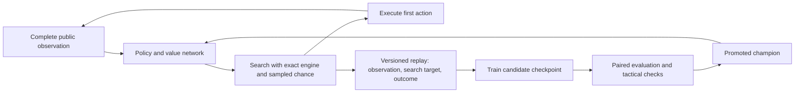

# Value-search learning: independent code and research audit

Date: 2026-10-11. Research checked online on this date. Scope: CRA versus CRA, level 100, no equipment, using the local engine. Reviewed plan: [value-search-audit.md](value-search-audit.md).

This audit combines local source inspection, controlled probes, saved data inspection, and primary research. It distinguishes **observed defects**, **patches observed during review**, **research findings**, and **proposed experiments**. It does not claim that any published algorithm guarantees a winning Dofus agent.

## 1. Recommendation

Keep the exact simulator and the narrow game scope. Establish a correct, measurable search baseline, then add a learned action prior alongside the value model. Train on versioned self-play with deliberate exploration and explicit replay sampling. Promote models using independent, paired evaluations with uncertainty estimates.

**Do not scale the current learning loop merely because export parity passes or validation accuracy rises.** The earlier generation run used a search policy with a severe budget regression; the current code still loses meaningful action sequences before evaluation. A stronger value model cannot select an action that search never presents to it.

The immediate objective should be a reproducible improvement in full-game performance at a fixed computation budget. Human-level strength is a later empirical milestone.

### Snapshot and concurrent changes

The workspace changed during this audit. No search, training, model, or dataset files were edited by this audit. Two source versions must be distinguished:

| Search snapshot | SHA-256 prefix | Relevant status |
| --- | --- | --- |
| Initial review | `f079b407be16be8b` | CPU cap incorrectly used match-wide applies; nonterminal values unbounded |
| Rechecked during review | `d22e1afd75779861` | CPU cap uses a per-decision delta; nonterminal rollout values clipped to ±999 |

The later version repairs the specific cumulative-budget failure and adds a terminal-value bound. It does **not** establish improved playing strength or complete all six fixes claimed by the plan. Findings below name their scope. Line numbers refer to these snapshots and may move in subsequent edits.

### Measured evidence

| Evidence | Result | Interpretation |
| --- | --- | --- |
| Earlier cap probe, same opening and reused counters | Retained cast states: 594, then 0, then 0 | Match-wide telemetry disabled later cast search |
| Later cap probe, same opening and reused counters | Retained cast states: 610, then 610 | Per-decision cap repair works in this probe |
| Later opening coverage, default 8,000 retained-node budget | 0 two-cast plans; 0 cast-then-move plans | Useful combination coverage remains broken in this fixture |
| V2 search shards `s0`, `s1` | Search side 0 wins / 180 games | Data describes a failing search policy |
| Saved `mirror-v2heur.jsonl` | 0 wins / 32 games | Historical failing run; not a benchmark of the later patch |
| Saved `mirror-v2net.jsonl` | 0 wins / 32 games | Historical failing run; not evidence isolating model quality |
| V2 enemy spell coverage | 11 class spells out of 21, plus a weapon slot | Ten CRA spells omitted |
| Enemy Tir Puissant cooldown 0 versus 5 | 0 changed V2 features | Its readiness is invisible |
| Isolated next-turn Expiation threat, cooldown 1 versus 0 | 0 versus 32 | Next-turn cooldown handling remains incomplete |
| V1 export parity | Maximum error `1.168e-6`, 8 observations | Numerically consistent on the parity pack |
| V2 export parity | Maximum error `1.112e-6`, 8 observations | Numerically consistent on the parity pack |

The match outcomes were decoded using match IDs, the encoded team perspective, and outcome labels. A balanced A/B win count does not imply a balanced search-versus-maison result, because the search seat alternates.

The recorded search failures do not prove the CPU bug was their sole cause. The counter probe independently establishes that defect. Existing game logs lack enough provenance to attribute every outcome to an exact source snapshot.

## 2. What the strongest relevant research actually supports

The following are primary papers, author explanations, or official implementations. The transfer recommendations are this audit's engineering judgments, not experimentally established results for this repository. Paper hyperparameters are not treated as universal defaults.

| Source | Established contribution | Recommended application here |
| --- | --- | --- |
| [AlphaGo, Silver et al., 2016](https://research.google/pubs/mastering-the-game-of-go-with-deep-neural-networks-and-tree-search/) | Combined learned move selection, position evaluation, and search; used expert data and self-play | A useful scripted teacher is a legitimate bootstrap; learn how to allocate search as well as how to judge leaves |
| [AlphaGo Zero, Silver et al., 2017; authors' explanation](https://deepmind.google/blog/alphago-zero-starting-from-scratch/) | Joint policy/value learning from search-driven self-play; removed the earlier rollout component | Feed search decisions back into policy learning; test whether maison continuations remain useful as the network improves |
| [AlphaZero, Silver et al., paper](https://arxiv.org/pdf/1712.01815) | Learns search-derived move distributions and final outcomes; search uses learned priors and values | Add a legal-action policy target and preserve the outcome target; distinguish this from value-only regression |
| [Expert Iteration, Anthony et al., 2017](https://papers.neurips.cc/paper_files/paper/2017/hash/d8e1344e27a5b08cdfd5d027d9b8d6de-Abstract.html) | Alternates planning with generalization of improved plans into a network policy | Save the expert's choices and candidate evaluations, then train a compact action-ranking model |
| [MuZero, Schrittwieser et al., 2019/2020](https://arxiv.org/abs/1911.08265) | Plans with learned dynamics that predict reward, value, and policy without supplied game rules | Retain the exact Dofus engine; learning replacement dynamics is unnecessary complexity at this stage |
| [Stochastic MuZero, Antonoglou et al., ICLR 2022](https://openreview.net/pdf?id=X6D9bAHhBQ1) | Models chance explicitly using afterstates and stochastic search; includes backgammon experiments | Separate decisions from dice outcomes and average returns over independent outcomes; do not treat a sampled result as certain |
| [Gumbel AlphaZero/MuZero, Danihelka et al., ICLR 2022](https://openreview.net/pdf?id=bERaNdoegnO) | Addresses failures of policy improvement under limited root-action coverage; studies sampling without replacement and sequential halving | A particularly relevant later candidate for allocating a small search budget across many actions; its guarantees do not automatically apply to the current hand-pruned planner |
| [KataGo, Wu, 2019; revised 2020](https://arxiv.org/pdf/1902.10565) | Demonstrates substantial efficiency gains using methods including varied search budgets, policy-target pruning, global context, and auxiliary targets | After correctness, test cheap versus expensive generation decisions and useful auxiliary predictions; measure improvement per unit compute |
| [Agarwal et al., NeurIPS 2021](https://arxiv.org/abs/2108.13264) | Shows why small-sample RL point estimates can give unreliable conclusions; advocates uncertainty-aware evaluation | Report intervals, paired differences, and variation across training seeds for architecture claims |
| [Wang et al., ICML 2023](https://arxiv.org/abs/2211.00241) | Finds exploitable weaknesses even in otherwise superhuman Go agents | Test diverse opponents and tactical counterexamples; beating one scripted policy does not establish robustness against humans |
| [DeepMind Mctx implementation](https://github.com/google-deepmind/mctx) | Provides batched implementations of search algorithms, including Gumbel MuZero | Use as an algorithm reference; avoid a JAX/engine migration unless profiling justifies it |

### What to adopt first

1. Correct transitions, legal actions, chance sampling, and value perspective.
2. An observation that preserves the public information needed to choose actions.
3. Search coverage of tactical alternatives, including setup and retreat.
4. Outcome learning plus learning to prioritize actions.
5. Versioned self-play, deliberate exploration, and controlled replay sampling.
6. Reproducible comparisons under a fixed time or compute allowance.

### What not to copy mechanically

- Go's assumption that the player changes after each atomic action. A CRA can move and cast repeatedly before passing.
- A fixed number of simulations, Dirichlet concentration, network size, or promotion percentage from another game.
- A learned world model when a usable exact simulator already exists.
- The assumption that every bounded search improves its input policy.
- The assumption that more search always helps when its evaluator or opponent model is biased.

## 3. Implementation findings and acceptance conditions

The linked source files are [search](../scripts/rl/search_bot.cjs), [encoder](../scripts/rl/encoder.cjs), [generator](../scripts/rl/value_gen.cjs), [trainer](../scripts/rl/train_value.py), and [inference](../scripts/rl/value_net.cjs).

### F01 — Match-wide CPU cap: patched during review; regression test still required

**Initial severity: critical.** In the initial snapshot, `search_bot.cjs:283` compared cumulative `counters.applies` against `3 * SB_BUDGET`. Counters are created once per match. The opening used 25,418 applies including rollouts, so later calls could generate movement starts but no cast descendants.

The later snapshot captures `applies0` and compares the difference at `search_bot.cjs:263,289`. Repeated opening probes then retained 610 cast states on both calls. Record this as a verified local repair, not an explanation that retroactively validates historical datasets.

**Acceptance:** multiple decisions with reused telemetry continue exploring casts. Search behavior must not depend on how much telemetry was accumulated before the decision. Keep a distinct local enumeration budget and lifetime reporting counters.

### F02 — Meaningful combination coverage remains absent at the opening

**Severity: high; observed on the later snapshot.** Moving budget consumption after pruning does not make empty-target simulation free. The CPU cap still expires before useful descendants are expanded. Sorting occupied cells first within each node does not prevent scanning the remaining empty targets before visiting the next node.

At `arene`, seed 1, CRA L100, the later implementation retained hundreds of cast states but no two-cast or cast-then-move plans. A depth of two can mean MOVE then CAST; it does not prove two-spell lookahead.

**Repair:** prefilter targets using effect semantics before `applyAction`, preserving valid AoE centers, self buffs, pushes, and terrain effects. Reserve expansion capacity for multiple positions and action sequences, or use a learned prior and progressive expansion. Do not reduce every spell to occupied targets: an empty AoE center can hit an enemy.

**Acceptance:** opening and midgame fixtures with legal two-cast, buff-then-attack, and attack-then-retreat plans produce those plans within the production budget. Report retained sequences by action pattern and first-action family, not just node count.

### F03 — Proposed-turn resampling remains partial; candidates have unequal evidence

**Severity: high; current source inspection and controlled scoring reproduction.** At `search_bot.cjs:362–389`, the first score still starts from the enumeration's sampled end state. Only two additional scores replay the proposed turn. Final selection still includes candidates with only their initial sample.

An initially seventh-ranked candidate can beat resampled finalists after their averages fall, without receiving the same independent checks. The first score also retains optimism introduced when candidates were selected using that sampled turn.

**Repair:** use enumeration to propose plans, then evaluate eligible final choices with fresh full-plan samples from the decision state. Equal sampling is the simplest baseline. A later adaptive allocation must explicitly handle uncertainty; it is not equivalent to the existing top-six loop. Stop replay when the acting fighter changes, the match ends, or a contingent action becomes illegal.

**Acceptance:** a proposed turn's damage/removal outcomes vary across independent samples; no unresampled candidate wins through the old eligibility path; a turn-ending outcome never causes the remaining plan to control the opponent. Sampling estimates agree with a larger independent rollout set on saved positions within measured sampling error.

### F04 — Terminal bounds repaired; heuristic calibration is still an open question

**Earlier severity: high.** Setting terminals to ±1,000 initially left the blended nonterminal value unbounded. A controlled state yielded heuristic value 1,317.34; a network prediction near +1 could produce a blended score around 1,461, above a terminal win.

The later snapshot clips the nonterminal return to ±999 at `search_bot.cjs:193–198`. This repairs the direct range violation at that return point. It does not turn HP-plus-threat into a calibrated probability, and saturation can erase differences among good positions.

The subsequent `−0.5 * planDepth` adjustment also changes the objective. Across differently sized plans, it can outweigh the one-point margin between a clipped leaf and a terminal win. Prefer an exact-outcome comparison and a true tie-break rule, not an unconditional utility penalty.

**Acceptance:** final candidate scoring respects terminal outcomes, every averaged value has a defined common utility, and separate value-only versus bounded-blend tests quantify whether the heuristic helps.

### F05 — V2 still omits almost half of the enemy CRA kit

**Severity: high; reproduced.** `encoder.cjs:282,375–380` allocates 12 enemy slots and reserves one for a weapon. CRA has 21 class spells. The omitted spells are:

`tir_puissant`, `fleche_harcelante`, `fleche_cinglante`, `fleche_persecutrice`, `fleche_destructrice`, `fleche_absorbante`, `fleche_ralentissante`, `fleche_explosive`, `maitrise_de_l_arc`, and `fleche_de_dispersion`.

Changing an enemy's Tir Puissant or Maîtrise cooldown from 0 to 5 changes no encoded features. Expiation, which is in the retained prefix, correctly changes two features. Thus the fix works for a prefix of the kit, not the full kit.

V2's signed buckets improve on V1 but still merge several distinct stats and effects. A maximum duration does not identify which of several stacked effects expires first. Spell boosts need the identity of the boosted spell. The encoder also uses raw `p1/p2` magnitudes where `p2 = -1` can be a sentinel, despite normalized `min/max` fields being available. These are additional representation concerns, especially before any generalization claim.

**Repair:** version a complete representation of both CRA kits and the relevant public active effects. Include state/spell identities and timing where they alter legal actions or damage. Preserve raw public observations or replayable matches so a future encoder correction does not require regenerating every game.

**Acceptance:** changing the readiness of every relevant enemy spell changes the intended features; opposite signed effects remain distinguishable; buff duration, spell-boost identity, and per-target restrictions have fixtures. V2 binary tensors alone cannot recover omitted information.

### F06 — Next-turn threat is still evaluated with inconsistent resources

**Severity: high; reproduced.** `search_bot.cjs:129–145` restores base PA/PM and clears `usedThisTurn`, but does not decrement cooldowns or clear `usedOnTarget`. It also ignores active resource buffs and penalties when assigning base PA/PM.

In the isolated probe, other enemy spells were disabled and the enemy had Expiation cooldown 1. The function returned 0; setting it to 0 returned 32. The engine decrements cooldowns, clears both usage counters, and applies `turnResources` when a turn starts. See `src/engine/engine.js:433–444` and `src/engine/formulas.js:128–132`.

**Repair:** define whether threat means “can attack now” or “can attack at its next turn,” and construct that state using the engine's timing semantics. Do not blindly decrement the current actor's cooldown a second time when it is already at the start of its turn.

**Acceptance:** threat fixtures cover cooldown 1, PA/PM removal, resource buffs, and exhausted per-target limits. Avoid claiming this greedy estimate is a full tactical threat calculation.

### F07 — The semantic state key is not semantically complete

**Severity: high; reproduced.** `search_bot.cjs:58–65` stores only effect count. Equal buffs with one versus three turns remaining produce the same key. Hazards and per-target uses are also omitted.

**Repair:** build a canonical key from fields that determine future public transitions, including effects and their identities/durations. Keep public-state equivalence separate from simulator RNG bookkeeping: exclude the real future RNG from the agent's information, but do not merge differing stochastic outcomes as if they had identical consequences.

**Acceptance:** equivalent dictionary order gives the same key; different strategically relevant effects, legal-use restrictions, or hazards give different keys. Use a small equivalence test corpus before introducing faster hashes.

### F08 — Nomination still throws away important alternatives

**Severity: medium/high; source inspection.** The dedicated setup path is a real improvement. However, damage nomination retains one line per sorted spell multiset; setup nomination retains one preferred-range position per multiset. This can erase spell order, target, or retreat distinctions. Taking the first five setup combinations also creates enumeration-order bias. The “setup” pool can include self-damaging casts because it is defined by lack of HP-score improvement, not positive preparatory effect.

**Repair:** nominate by tactically distinct consequences and first actions, preserving several useful endpoints where justified. Include the maison action/plan as a benchmark candidate so the purported improvement operator can actually consider its reference action. Compare that candidate under the same sampling protocol.

**Acceptance:** attack-in-place and attack-then-retreat can both reach evaluation; buff and poison fixtures survive; irrelevant self-harm does not crowd out useful setup; candidate recall is measured against an expensive reference search on a small position set.

### F09 — Shard writing is unbounded and progress logs are not checkpoints

**Severity: medium; observed and source-confirmed.** `value_gen.cjs:35–37,50–93` runs the full match loop synchronously and ignores writable-stream backpressure. Earlier round-two workers had logged 50 completed games while their binary output files had not yet been created. Work can remain buffered until the loop finishes.

**Repair:** bounded writes per completed match, actual backpressure handling, resumable match checkpoints, temporary files, and an atomic completion manifest. A manifest should appear only after all files are flushed and their sizes validated.

**Acceptance:** disk progress advances during a shard; memory does not scale with total shard size; interruption loses at most the declared checkpoint interval. Do not confuse an incomplete shard with a corrupt completed shard.

### F10 — Feature-version exports can misdescribe the model

**Severity: high when using the trainer's current defaults.** The trainer derives dimensions from data but unconditionally exports `featureVersion: 2` at `train_value.py:171`. Its default paths still point to `value-cra1`. Training the default V1 data can therefore produce a 4,082-input model declared as V2; `useValueModel` then chooses the 5,126-feature encoder from that declaration.

The parity pack can miss this: it compares inference on the same pre-encoded training-format tensors rather than exercising the live encoder selected by the manifest.

**Repair:** validate and propagate feature version from all shard manifests; reject incompatible versions even when dimensions match; validate model dimensions and schema at load time. Add live-view-to-Python/JS parity, not only tensor-to-output parity.

**Acceptance:** V1 and V2 data either export their actual versions correctly or fail clearly; mixed schemas fail; a saved live observation has matching training and runtime features.

### F11 — Match splitting is local to a dataset layout, not stable across rounds

**Severity: medium; source-confirmed.** `train_value.py:49–63,100` adds offsets determined by earlier shards before taking match ID modulo 17. Adding an earlier-sorting shard changes the validation membership of old games. Repeating an identical generated match in another shard can also give it a different split identity.

The existing within-run split is by match. This finding does not claim that every current validation score contains within-match leakage. It means the holdout is not persistent and duplicate games are not protected by a stable identity.

**Repair:** derive match identity from immutable generation configuration, seed, and policy identifiers; assign its split before writing shards; detect duplicate trajectories. Keep evaluation seed families out of training and replay augmentation.

**Acceptance:** shard reordering, renaming, and appending preserve the split of existing match identities; duplicated games cannot cross train/validation boundaries.

### F12 — The proposed training and opponent-pool machinery is not implemented yet

**Severity: planning gap.** The generator offers maison-versus-maison or one search side versus maison. The search module has one global `leafEval`; `SB_SELF` applies the same model on both sides. This does not implement `bot(V_new)` versus `bot(V_old)` or an independently versioned opponent pool.

The trainer initializes a new network, runs a fixed number of epochs, and exports the final epoch. It does not implement the plan's early stopping or best-validation-checkpoint selection. NumPy shuffling is seeded, but the code does not seed model initialization with `torch.manual_seed`.

**Repair:** independent bot instances with their own model, planner RNG, and budget state; explicit player assignments; immutable champion checkpoints; best-checkpoint selection and full training configuration/seeds. Record whether training starts fresh or warm-starts.

**Acceptance:** two different model fingerprints are demonstrably used in a head-to-head game; swapping seats swaps those assignments; training can reproduce its split/order/configuration; “early stopping” is reported only when implemented.

### F13 — Evaluation and generation provenance is insufficient

**Severity: medium; source-confirmed.** Mirror logs omit engine/search/model fingerprints, seed offset, planner seed, and active probes. Shard metadata omits the generating model and engine revision. Global `planRngSalt` also makes planner randomness depend on preceding decisions and games in the process.

**Repair:** record explicit per-game engine and planner seeds, source/configuration digests, both bot versions, map, seat assignment, outcomes, termination reasons, invalid actions, and latency. Derive planner streams from a stable game/decision identity rather than process history.

**Acceptance:** a logged game can be rerun alone; changing worker count or game order does not silently change its configured planner randomness. An append-only log cannot mix configurations without an explicit run identifier.

### F14 — A fixed maison continuation is a policy assumption, not quiescence

**Severity: design limitation requiring experiments.** Three scripted turns do not establish tactical quietness. The bias is action-dependent: a setup that requires a particular follow-up can be undervalued because maison does something else. Training values from mixed search/pool policies while evaluating after maison continuations adds a further distribution mismatch.

**Repair:** call this a fixed-horizon policy rollout; instrument tactical instability at the cutoff. Compare shorter/longer horizons, direct learned leaves, and an improved continuation policy at matched cost. Keep an opponent pool in external evaluation even if the inner rollout remains cheap.

**Acceptance:** continuation policy and horizon are logged; their benefit is measured in full matches and candidate-ranking probes. “Bias cancels” remains an unverified hypothesis unless an experiment establishes it.

## 4. Recommended learning design for this game

### Preserve the parts that already make sense

The exact engine, fair separation of planning dice from real dice, outcome supervision, match-level splitting within a training run, and cross-language numerical parity are useful foundations. The CNN is not disqualified by its size. The retired PPO pipeline's results do not establish that a policy head used to guide search would fail: those are different uses of a network.

Learning final outcomes with mean squared error is a valid Monte Carlo value-learning baseline. It is not temporal-difference learning merely because observations are collected during play. Early positions have uncertain outcomes, so imperfect outcome prediction is expected even with a good representation.

For a fixed continuation policy, define the target explicitly:

```text
z = +1 for a win, 0 for a draw, -1 for a loss
v(s, player) = E[z | public observation s, specified continuation policies]
             = P(win) - P(loss)
expected match score = (v + 1) / 2
```

With draws, `(v + 1) / 2` is expected score when a draw earns half a point; it is not the probability of winning. A value learned from maison continuations is not automatically an optimal-play value. Mixing policies without controlling their distribution changes the function being fitted.

### Target architecture



The diagram is a proposed destination. The current implementation contains value learning and a turn planner; it does not yet contain the policy-target feedback path or independent champion/candidate instances.

| Component | Recommended contract | Why it matters here |
| --- | --- | --- |
| Public state | Complete relevant CRA spells, resources, statuses, timing, map and acting side | Prevents identical inputs for tactically different situations |
| Actions | Legal `MOVE`, `CAST`, `PASS`, with explicit action identity | Matches the engine and existing atomic replanning |
| Policy | Probability or ranking over legal actions | Allocates scarce exploration to useful branches |
| Value | Expected outcome from a declared player's perspective | Makes training, search backup and terminal returns agree |
| Chance | Independent simulated outcomes after decisions | Estimates risk without reading the match's future RNG |
| Search target | Distribution derived from the actual search procedure | Teaches the network what the planner learned |
| Replay | Versioned observations, targets, outcomes and provenance | Enables diagnosis and controlled iterative training |

### Use an incremental migration

1. **Repair the present planner and establish its strength.** Keep it as an interpretable baseline. Correctness and tactical coverage are prerequisites for trusting its training targets.
2. **Add an action-ranking prior.** Begin by guiding expansion or ranking candidates. This can address the observed branching problem without immediately replacing all search code. Log candidate identity, search effort, and scores now so these targets can be studied.
3. **Compare against a policy/value tree search.** Use the exact engine, explicit chance sampling, and atomic actions. Evaluate standard prior-guided search and, if low simulation counts remain limiting, a Gumbel-style allocation method. This is an experiment, not a guaranteed upgrade.

A full-turn plan prior is another possible design, but variable-length plans, dice-dependent legality and order-sensitive actions complicate its target space. Atomic actions are the more direct fit to the current “execute one action, then replan” interface. A flat 5,251-action head or a factorization over action type/spell/target should be chosen by measurement; neither is mandated by AlphaZero.

### Value perspective must follow the player, not tree depth

Several successive `MOVE`/`CAST` edges can belong to the same player. An implementation that negates value at every edge will be wrong. Choose one invariant:

- Store values from a fixed team's perspective throughout search; maximize for that team and minimize for its opponent.
- Store actor-relative values and negate only when converting between different players' perspectives.

Chance nodes average outcomes. They do not themselves justify a sign change. Include tests for move → cast by the same fighter, pass → opponent turn, turn-ending critical failure, death, and draw. This is a requirement for a future tree search, not a claim that the current outcome labels have this sign bug.

### Learn what search discovers

For a policy/value model, a starting objective is:

```text
loss = value_weight * (z - v(s))^2
     + policy_weight * cross_entropy(search_policy(s), policy(s))
     + regularization
```

This follows the joint learning structure described in [AlphaZero](https://arxiv.org/pdf/1712.01815); loss weights and targets must be validated for this engine. A separate win/draw/loss head is optional if calibration and draws justify it.

Do not silently label every unvisited legal action as bad. The policy target must account for what search actually evaluated. Visit distributions from a properly implemented tree search, a selected expert action, and softmaxed rollout scores are different supervision schemes. The last two are reasonable experiments, but should not be reported as equivalent to AlphaZero's target.

Keep legacy outcome-only samples eligible for value loss if their schema and provenance are valid. Apply policy loss only to records that actually have a valid policy target. A failed planner's confident choices should not automatically become the new policy's teaching signal.

### Handle stochasticity and replanning consistently

Separate randomness used to **propose** a line from randomness used to **evaluate** it. An optimistic proposal sample is not an unbiased final score. Common random numbers can reduce variance in differences when they induce useful correlation; differing action sequences consume random draws differently, so reusing a seed alone does not guarantee a benefit. Measure paired score variance with and without this coupling.

Also define the rollout policy after a sampled cast failure or kill changes the turn. An open-loop plan must stop at an actor change. A policy tree can instead branch on the observed result. Because the live bot replans, compare the simpler fixed-plan estimator with a cost-controlled replanning estimator on a small frozen position set before paying that cost everywhere.

## 5. Data and training protocol

### What the current data does and does not show

| Dataset | Positions | Matches | Search-game positions | Main limitation |
| --- | ---: | ---: | ---: | --- |
| V1 completed shards | 368,816 | 6,120 | 7,976 | 97.84% of positions from maison games; incomplete encoding |
| V2 completed shards reviewed | 369,141 | 6,180 | 8,301 | Search side lost all 180 search games; encoder still omits information |

The V1 binary-size and outcome-consistency checks passed. Export parity passed for both saved models. These checks establish useful plumbing properties; they do not establish a strong decision policy.

Hundreds of thousands of positions are not hundreds of thousands of independent outcome observations. Positions from one game share the final label and a trajectory. Random legal exploration also does not inherently “corrupt” the outcome label: the outcome is correct for the behavior policy that generated the game. Exploration changes state coverage, continuation policy and target variance.

Archive the failing V2 search games with an explicit generating-policy status. They are useful counterexamples. Do not treat them as evidence of improved self-play, and do not automatically discard every losing trajectory: learning from losses is necessary. Decide their training weight through a controlled replay ablation.

### Make the training distribution intentional

The original 40/25/20/15 game mix is a proposal, not an established optimum. It also does not determine the training distribution when all historical positions are pooled uniformly: older maison data and longer games can dominate the minibatches.

Start with current-champion self-play as the main source, retain older champions and maison as anchors, and keep a separate tactical fixture set. Record the actual batch fractions by policy generation, map, game phase and outcome. Adjust the mixture from observed failures rather than selecting percentages because another game used them.

| Sampling decision | Explicit choice to make | Diagnostic |
| --- | --- | --- |
| Old versus recent games | Recent window or recency-weighted replay | Fraction of batches from each generation |
| Current versus older opponents | Named pool and sampling weights | Results against every pool member |
| Matches versus positions | Position-uniform or match-balanced sampling | Influence of long games |
| Full versus cheap search | Which records receive policy targets | Strength and target quality per compute hour |
| Exploration | Training-only distribution over plausible actions | State diversity and avoidable blunders |
| Wins/losses/draws | Natural or deliberately reweighted frequencies | Calibration under evaluation distribution |

KataGo provides evidence that varied generation budgets and selective training targets can improve efficiency in Go, not a universal recipe for this game. Its implementation choices should motivate a measured alternative to paying maximum search cost at every generated decision. See the [primary paper](https://arxiv.org/pdf/1902.10565).

### Persist enough information to debug the next round

Each completed match needs an immutable identity, public observation or replayable trajectory, both bot/model identifiers, engine/content/search fingerprints, encoder schema, map/loadout, engine seed, separate planner seeds, exploration settings, limits, outcome and termination reason. Policy targets need legal-action identity, search budget and target-generation version.

Record genuine engine draws separately from an external action-limit abort. If the intended benchmark defines the action limit as a draw rule, include it in the declared game objective and use it consistently in generation, search and evaluation. Otherwise, an unfinished game should not silently become a genuine draw label.

Split by stable match families before encoding. Related deterministic reruns and augmented views of one game belong to the same partition. Keep promotion seed families separate from training and development. Preserve schema information with each shard; reject mixed incompatible data before allocating a training job.

### Training controls

- Save the best validation checkpoint and its selection criterion. Record the full learning-rate schedule, batch size, optimizer, training duration, initialization and RNG seeds.
- Distinguish fresh initialization from warm-starting. Compare them only after the basic loop is stable.
- Evaluate value loss and calibration separately on maison games, current search games, early/middle/late states, and each supported map. Never select an architecture from a single aggregate accuracy number.
- Verify live encoding as well as tensor inference parity. The current maximum errors near `1.2e-6` are a useful reference; the plan's `2e-3` threshold is much looser and needs a reason if retained.
- Use multiple training seeds when claiming an architecture or training method is superior. A single candidate checkpoint can still be evaluated for deployment on its own merits.

The V2 network has **517,665 parameters**, compared with **384,033** for V1. Update model-size and generation-cost statements with the actual schema and source version; historical timings from a broken search policy do not predict repaired-search throughput.

## 6. Evaluation that can establish progress

### Why the current promotion gate is weak

At 64 decisive games, “at least 55%” means at least 36 wins. Under an illustrative independent fair-coin null, the chance of obtaining at least 36 wins is **19.1%**. That threshold alone is not strong evidence of improvement. Real paired games are correlated, so the actual evaluation should analyze pairs rather than use this coin model.

| Result | Point estimate | Illustrative 95% Wilson interval under independence |
| --- | ---: | ---: |
| 36/64 | 56.3% | 44.1%–67.7% |
| Historical heuristic, 37/64 | 57.8% | 45.6%–69.1% |
| Historical V1 net, 29/64 | 45.3% | 33.7%–57.4% |
| Budget probe, 11/16 | 68.8% | 44.4%–85.8% |

These intervals illustrate scale only. They are not corrected confidence intervals for the repository's paired-seed experiment, and overlap is not itself a test of the paired difference. The saved game-level records are needed for the proper comparison.

The plan's “no regression by more than two percentage points” gate also requires an uncertainty criterion and substantially more evidence than a 64-game point estimate. Choose a practically meaningful margin and estimate the required budget from paired variability. Do not present a small benchmark as certifying a two-point tolerance.

### Define the comparison before running it

| Item | Required protocol |
| --- | --- |
| Primary outcome | Match score: win 1, draw 0.5, loss 0 |
| Primary comparison | Candidate versus frozen champion, both seat assignments per seed |
| Judge attribution | Identical search configuration, network versus heuristic, on matched seed blocks |
| Secondary opponents | Maison and a fixed set of older/tactically different bots |
| Scope | Explicit CRA L100 loadout and map distribution |
| Compute | Same declared production latency limit; report work and elapsed time |
| Randomness | Logged engine seeds and separate reproducible planner seeds |
| Statistical unit | Seed pair, with any planner replicas clustered within it |
| Stopping | Predeclared sample size, or a valid sequential procedure |
| Decision | Promote, reject, or inconclusive |

For each head-to-head seed pair, average the candidate's scores from both seats. Estimate the mean and uncertainty by resampling independent seed pairs. For comparisons against a common opponent, form a within-seed difference between configurations, preserving both seat assignments, before estimating uncertainty. Do not bootstrap individual positions or treat deterministic repeats as new independent games.

Repeated use of the same seeds **across different configurations** is useful experimental control. Replaying the identical deterministic configuration on them does not add evidence. Fix `planRngSalt` provenance before assuming the current harness cleanly implements either case.

### Separate development from confirmation

1. Maintain a small fixed tactical and match suite for debugging. Reusing it is deliberate; do not call it a holdout after tuning against it.
2. Use approximately 64 games as a smoke test for obvious collapse, illegal actions and throughput. A promising score qualifies the candidate for confirmation; it is not a promotion certificate.
3. Predeclare a fresh confirmatory budget based on the improvement worth detecting and pilot variance. For planning, 256 seed pairs/512 games is a possible first budget, **not a guarantee of sufficient power**, especially for a two-point margin.
4. Use one primary promotion question. Treat additional opponent and map results as robustness checks with declared tolerances; account for multiple comparisons if making formal claims about all of them.
5. At the fixed endpoint, require the chosen uncertainty bound to clear the declared improvement threshold. If evidence is insufficient, report “inconclusive.” Do not repeatedly recompute an ordinary 95% interval and stop the first time it passes.

For an architecture change, repeat training with different initialization/data-order seeds once pilot results justify the cost. This distinguishes a method-level improvement from one fortunate checkpoint. The statistical concerns are consistent with [Agarwal et al.](https://arxiv.org/abs/2108.13264); the paired protocol above is this audit's proposed adaptation to this engine.

### Measure the part that fails

| Layer | Useful measurement | Interpretation |
| --- | --- | --- |
| Action legality | Invalid actions and fallback passes by cause | Separates planner failure from weak strategy |
| Enumeration | Useful sequence coverage, first-action diversity, apply count | Reveals whether good lines can reach evaluation |
| Nomination | Recall of strong reference candidates | Reveals losses caused by pruning |
| Stochastic ranking | Independent rollout variance and ranking stability | Reveals whether three samples are sufficient |
| Value prediction | MSE, calibration, win/draw/loss calibration if available | Checks the declared outcome estimate |
| Tactical choice | Missed forced wins, avoidable losses, setup/retreat fixtures | Measures decision consequences |
| Candidate ranking | Agreement/regret versus expensive independent evaluation | Connects value estimates to chosen actions |
| Full matches | Paired score with uncertainty against each reference | Establishes actual playing strength |
| Runtime | Median/p95 latency, engine applies, NN calls, memory | Establishes feasibility at the intended budget |

An expensive reference rollout is still only an estimate under its continuation policy, not an oracle for optimal play. Preserve that limitation when reporting ranking accuracy or regret.

The earlier V1 check on 2,048 held-out positions found 75.9% winner-sign accuracy versus 72.1% for an HP-sign rule; late states were substantially easier than early states. This demonstrates that aggregate accuracy can be an unhelpful headline. It does **not** establish that “most of the network is reading HP.” That claim needs feature ablation or controlled counterfactuals.

The current evaluation map is `arene`; generation uses five maps. If the objective remains `arene` only, say so. If claiming strength across those maps, report per-map scores and a declared aggregate. Neither a fixed CNN shape nor an encoder version establishes class/gear generalization.

## 7. Implementation order and experiment budget

### Proceed through measurable milestones

| Phase | Work | Exit condition |
| --- | --- | --- |
| A: trustworthy planner | Lock the per-decision cap repair; fix coverage, full-plan sampling, terminal comparison, threat timing and state equivalence | Targeted fixtures pass; no cast collapse across decisions; reproducible baseline matches |
| B: trustworthy data | Complete CRA public encoding; schema validation; streaming/checkpoints; stable split and run manifests | Live encoder parity and shard checks pass; interrupted generation resumes correctly |
| C: small learning pilot | Independent champion/candidate instances; controlled replay; best-checkpoint training | Candidate can be trained, evaluated and reproduced end to end |
| D: learn search allocation | Add action-ranking/policy targets; compare guided planner and policy/value search | Better tactical coverage or match score at the same useful latency |
| E: scale | Expand self-play, opponent diversity, search budgets or model capacity selectively | Repeated measurable gains per compute hour; preserved robustness |

Do not require a large training run to discover an action-legality or search-coverage bug. A small pilot of a few hundred games can exercise the pipeline and estimate cost; it cannot by itself guarantee competitive strength.

### Keep the first ablations small and interpretable

Freeze source, encoder, opponents, seeds and budget for each comparison. Change the item named in the row; do not simultaneously change the dataset, search budget and evaluator and attribute the result to the network.

| Comparison | Question | Main evidence |
| --- | --- | --- |
| Repaired heuristic planner versus maison | Is the calculator itself competitive? | Paired match score and tactical fixtures |
| Fixed candidates: 3 versus more independent samples | Is ranking dominated by dice noise? | Ranking stability, regret estimate, latency |
| Heuristic versus value-only versus bounded blend | Does the learned judge improve decisions? | Matched-budget matches and candidate ranking |
| Maison-heavy versus deliberately weighted recent replay | Is the data distribution limiting learning? | Search-state calibration and full matches |
| Same model, prior disabled versus enabled | Does learned allocation recover useful branches? | Coverage, work, score at matched time |
| Current versus older/different rollout opponents | Is the bot exploiting one continuation model? | Opponent-specific and pooled performance |

Use a fixed-position probe to reject clearly broken variants cheaply, then run match comparisons on the survivors. Protect the final promotion set from this selection process.

### Profile before buying capacity

Measure time in target enumeration, `applyAction`, state cloning/key construction, scripted rollouts, encoding and JS inference. Track actual applies separately from retained states. An 8,000-node label can hide very different CPU costs between versions.

The current JS network may benefit from batching or a different inference backend, but neither is justified without a profile. Faster hashing requires correct state equivalence first; cached values require a complete key plus model/schema identity. More workers can reduce throughput if they compete for the same CPU or memory bandwidth.

Report both algorithmic work and end-to-end latency. Equal node counts help explain an algorithm; equal time allowances answer whether it is a better game bot. Include generation hours, training time and evaluation cost when reporting improvement per round.

A plateau requires stable correctness, sufficient evaluation power, and an unchanged objective. Two failed 64-game promotion attempts do not distinguish a real plateau from noise. Diagnose which metric stalled before choosing more data, a larger network or deeper search.

## 8. Corrections to the original plan

| Original statement or implication | Recommended replacement |
| --- | --- |
| “Six findings, all verified, all fixed” | State partial fixes separately; require each finding's acceptance test |
| “Semantic state key” | Current key omits transition-relevant effect details and restrictions |
| Three scripted turns mean quiescence | Fixed-horizon maison-policy continuation; quietness is not established |
| Relative ranking absorbs most rollout bias | Action-dependent bias must be measured |
| All three samples resample the proposed turn | Only two do; the initial score and nonfinalists retain the earlier path |
| Terminal ±1,000 solves the objective mismatch | Later clipping fixes a bound; blend calibration and depth penalties remain |
| V2 includes enemy readiness | Only 11 of 21 enemy CRA spells are encoded |
| Search is a teacher permanently ahead of its student | Bounded search is an attempted policy improvement, verified empirically |
| Noise corrupts outcome labels | Outcomes remain valid for the noisy behavior policy |
| 75.9% versus 72.1% proves the model mostly reads HP | Requires ablation; aggregate winner accuracy is insufficient |
| Clairvoyance establishes the sole base flaw | Diagnostic evidence of sensitivity to chance, not causal isolation of all failures |
| 4k → 8k establishes a 20-point strength gain | Small, differing seed blocks motivate a controlled budget comparison |
| Always use fresh seeds | Match seeds across configurations; reserve fresh blocks for confirmation |
| 55% over 64 games establishes promotion | Smoke test followed by uncertainty-aware confirmation |
| Two failed rounds establish a plateau | Require adequate power and layer-specific diagnosis |
| Pool play and early stopping are part of the running loop | They are planned work; current interfaces do not implement them |
| Search plus heuristic is a proven 57.8% champion | Historical estimate from another configuration; freeze and remeasure |
| One round costs 1–1.5 hours | Reprofile after repaired search and documented hardware/worker settings |
| Encoder is already class/level/gear-general | Scope support requires representation checks and out-of-scope evaluations |

The overall direction—an exact calculator supported by learning—is reasonable. The central revision is to make learning improve **action selection and search allocation**, while requiring evidence that every supposed improvement actually improves the played policy.

## 9. Reproduction appendix

Run these commands from the repository root. They read existing data and instrument source in memory; they do not overwrite the planner or model. Results describe the source fingerprints in section 10. Revisit the probes when those sources change.

### Numerical export parity

```bash
node scripts/rl/value_net.cjs parity local-observations/rl/value-cra1/model
node scripts/rl/value_net.cjs parity local-observations/rl/value-cra2/model
```

Observed outputs:

```json
{"n":8,"maxDiff":0.000001168,"ok":true}
{"n":8,"maxDiff":0.000001112,"ok":true}
```

This checks the saved tensor pack, not live encoder completeness, action quality, or the trainer's schema-export bug.

### Repeated-decision budget and sequence coverage

This intentionally calls the planner twice on the same opening with reused telemetry. It isolates dependence on accumulated counters; it is not a full match evaluation.

```bash
SB_BUDGET=8000 SB_CLAIRVOYANT=0 node <<'JS'
const fs = require('node:fs');
const path = require('node:path');
const Module = require('node:module');
const file = path.resolve('scripts/rl/search_bot.cjs');
let source = fs.readFileSync(file, 'utf8');
const marker = '  // Nomination: fins';
if (source.split(marker).length !== 2) {
  throw new Error('Probe needs review for this source version');
}
source = source.replace(marker, `  counters.auditCoverage = {
    castStates: ends.filter(e => e.acts.some(a => a.type === 'CAST')).length,
    twoCasts: ends.filter(e => e.acts.filter(a => a.type === 'CAST').length >= 2).length,
    castThenMove: ends.filter(e => e.acts.some((a, i) => a.type === 'MOVE' && e.acts.slice(0, i).some(b => b.type === 'CAST'))).length
  };\n${marker}`);
const probe = new Module(file, module);
probe.filename = file;
probe.paths = Module._nodeModulePaths(path.dirname(file));
probe._compile(source, file);
const sb = probe.exports;
const { createGame } = require('./src/engine/engine');
const { state } = createGame({
  mapId: 'arene', seed: 1,
  fighters: sb.makeFighters('l100', 'CRA', 'CRA')
});
const counters = { applies: 0, ms: 0, decisions: 0, endsSum: 0, invalid: 0 };
for (let call = 1; call <= 2; call++) {
  sb.searchDecide(state, counters);
  console.log(JSON.stringify({ call, applies: counters.applies, ...counters.auditCoverage }));
}
JS
```

Observed on the rechecked snapshot:

```json
{"call":1,"applies":25449,"castStates":610,"twoCasts":0,"castThenMove":0}
{"call":2,"applies":50852,"castStates":610,"twoCasts":0,"castThenMove":0}
```

The cap regression is repaired in this fixture; useful combination coverage is not. `applies` includes later scoring work, so it is not the number of retained enumeration nodes.

### Decode search-side outcomes instead of A/B totals

Both V2 search manifests report 45 A wins and 45 B wins. The generator alternates which side is search. This script reconstructs the result for that side using the saved V2 team indicator:

```bash
python3 <<'PY'
import json
from pathlib import Path
import numpy as np

for name in ('s0', 's1'):
    p = Path('local-observations/rl/value-cra2/shards') / f'{name}.meta.json'
    meta = json.loads(p.read_text())
    assert meta['featureVersion'] == 2 and meta['mode'] == 'search'
    base = str(p).removesuffix('.meta.json')
    n, d = meta['records'], meta['obsDim']
    obs = np.memmap(base + '.obs.f32', dtype='<f4', mode='r', shape=(n, d))
    z = np.memmap(base + '.z.f32', dtype='<f4', mode='r', shape=(n,))
    mids = np.memmap(base + '.m.u32', dtype='<u4', mode='r', shape=(n,))
    ids, first = np.unique(mids, return_index=True)
    # V2 globals: team-A indicator is the seventh feature from the end.
    team_a_result = z[first] * (2 * obs[first, -7] - 1)
    search_a = (ids.astype(np.int64) - meta['seed0']) % 2 == 0
    search_result = np.where(search_a, team_a_result, -team_a_result)
    print(name, {
        'matches': len(ids),
        'search_wins': int((search_result == 1).sum()),
        'search_losses': int((search_result == -1).sum()),
        'draws': int((search_result == 0).sum())
    })
PY
```

Observed outputs:

```text
s0 {'matches': 90, 'search_wins': 0, 'search_losses': 90, 'draws': 0}
s1 {'matches': 90, 'search_wins': 0, 'search_losses': 90, 'draws': 0}
```

This decoder depends on the reviewed generator's seat-alternation rule and the V2 schema. Future manifests should store the search-side result directly.

### Regression fixtures to add before the next large run

These are proposed acceptance tests, not a claim that a production test suite was added by this audit.

| Fixture | Required result |
| --- | --- |
| Reused telemetry across turns | Cast search remains available |
| Legal buff → attack and attack → retreat | Plans survive enumeration and nomination |
| Cooldown 1 at next-turn boundary | Spell becomes available at the correct time |
| Same effect count, different duration or type | State keys and intended features differ |
| Every enemy CRA spell's cooldown changes | Relevant readiness features change |
| Different restrictions on the same target | Legality and state identity remain distinguishable |
| Proposed critical failure ends turn | Plan replay stops before controlling another actor |
| Sampled first-round kill versus no kill | Independent evaluations branch correctly |
| Certain terminal win versus high clipped nonterminal | Action-count tie-break cannot reject the win |
| Equal candidates with different proposal luck | Final ranking uses the declared fresh sampling rule |
| V1 default trainer output | Correct schema export, or explicit rejection |
| Shard rename, reorder and append | Existing match split identities remain stable |
| Aborted generation process | Valid completed prefix and resumable checkpoint |
| Old versus new model in one match | Correct model identity on each side |
| Rerun one game outside its original batch | Same configured planner and engine streams |

## 10. Audit provenance and limits

### Source fingerprints

The final local checks used these fingerprints. They identify the reviewed files; they are **not** a fingerprint of the entire dirty engine/content dependency tree. Future benchmark manifests should identify that complete runtime too.

| Artifact | SHA-256 |
| --- | --- |
| `scripts/rl/search_bot.cjs`, initial snapshot | `f079b407be16be8bb80d4a915dd9b1b1fca95e54a10d539ec2a4a64773ab1230` |
| `scripts/rl/search_bot.cjs`, rechecked snapshot | `d22e1afd75779861077cbad75470537d55b23496bf7716ef88f5eea75f3b46bd` |
| `scripts/rl/encoder.cjs` | `067abd97284fb73d505ce1b7b73e39107f4f24f3eedf21d367621600186ea4b1` |
| `scripts/rl/value_gen.cjs` | `1efc8b2fbfd6ce38503e736c29ea09cff54db84a1cb8950211d9bb693d8fdf30` |
| `scripts/rl/train_value.py` | `f0171d663baf0703456b3ff104c75468f339f967e4680a8c352a18bcdb28b1c3` |
| `scripts/rl/value_net.cjs` | `597cacf3ed931608a3ed0ae8e09160ee0809cdc2c8ba4764e641bc745b60fe32` |
| `scripts/ai_runtime.cjs` | `9461b43e795554ac6439310cc526d29a720b9235891071c302449b2c3903c50b` |
| Original `docs/value-search-audit.md` | `73493b739291fdf9e494ba53d86c7c43d5c2843cbf2f8702cff342b43495f0d1` |
| V2 `model/weights.bin` | `960ab13bf1078b24c1c35490fb86b63e106687092f2f70d018407e2fd63db768` |
| V2 `model/shapes.json` | `bc418e0f2c233d98baa2d669ca33d08a13564ef9f847830cd07bf69988a11007` |

### Evidence boundaries

- Source inspection and local probes establish the specific defects and repairs described above. Probes exercise selected states, not every reachable state.
- Historical logs and shard outcomes describe the generating runs. Missing run fingerprints prevent complete attribution to an exact code snapshot.
- This audit did not run a full tournament after the concurrent cap/clipping patch, train a new model, or regenerate a clean dataset. It therefore makes no claim about the repaired version's current win rate.
- The primary research supports the algorithmic comparisons in section 2. Applying them to Dofus remains an engineering hypothesis until tested under the declared protocol.
- Only this report was authored for the present research-and-documentation request; production code, model weights and datasets were not modified by the audit.
